# AWS Terraform and Ansible Web Server

## Project Overview

This project demonstrates infrastructure provisioning and configuration management using **Terraform** and **Ansible** on AWS.

Terraform is used to provision:

- EC2 instance
- S3 bucket
- IAM role
- IAM instance profile
- Security group

Ansible is then used to connect to the EC2 instance, install and configure **Nginx**, and deploy a simple web page displaying **Hello, World!**

The project is deployed in the AWS **us-east-2** region.

---

## Architecture

```text
Local Mac
   |
   |-- Terraform
   |      |
   |      +-- EC2 Instance
   |      +-- S3 Bucket
   |      +-- IAM Role
   |      +-- IAM Instance Profile
   |      +-- Security Group
   |
   |-- Ansible
          |
          +-- SSH to EC2
                 |
                 +-- Install Nginx
                 +-- Start and enable Nginx
                 +-- Deploy index.html
                        |
                        +-- Hello, World!
```

Terraform provisions the infrastructure, while Ansible configures the EC2 server.

---

## Technologies Used

- AWS
- Terraform
- Ansible
- Amazon EC2
- Amazon S3
- AWS IAM
- AWS Security Groups
- Nginx
- Ubuntu Linux
- AWS CLI
- Git
- GitHub

---

## Project Structure

```text
aws-terraform-ansible-webserver/
|
├── terraform/
│   ├── provider.tf
│   ├── variables.tf
│   ├── security.tf
│   ├── iam.tf
│   ├── s3.tf
│   ├── ec2.tf
│   └── outputs.tf
|
├── ansible/
│   ├── inventory.ini
│   └── webserver.yml
|
├── screenshots/
│   ├── 01-terraform-init.png
│   ├── 02-terraform-validate.png
│   ├── 03-terraform-plan.png
│   ├── 04-terraform-apply.png
│   ├── 05-terraform-outputs.png
│   ├── 06-aws-ec2-running.png
│   ├── 07-aws-s3-bucket.png
│   ├── 08-aws-iam-role.png
│   ├── 09-security-group.png
│   ├── 10-ansible-ping.png
│   ├── 11-ansible-playbook-success.png
│   ├── 12-hello-world-website.png
│   └── 13-terraform-state.png
|
├── .gitignore
└── README.md
```

Sensitive Terraform files such as `terraform.tfvars`, Terraform state files, `.terraform/`, and private key files are excluded from Git using `.gitignore`.

---

# Prerequisites

The following are required:

- AWS account
- AWS CLI
- Terraform
- Ansible
- Git
- Existing EC2 SSH key pair

Verify AWS CLI access:

```bash
aws sts get-caller-identity
```

Verify the configured region:

```bash
aws configure get region
```

Project region:

```text
us-east-2
```

Verify Terraform:

```bash
terraform --version
```

Verify Ansible:

```bash
ansible --version
```

---

# Terraform Infrastructure

## AWS Provider

Terraform uses the AWS provider with the AWS region configured through a variable.

```hcl
provider "aws" {
  region = var.aws_region
}
```

Region used:

```text
us-east-2
```

---

## Variables

The Terraform configuration defines variables for:

- AWS region
- EC2 instance type
- EC2 key pair

Example:

```hcl
variable "aws_region" {
  description = "AWS region"
  type        = string
  default     = "us-east-2"
}

variable "instance_type" {
  description = "EC2 instance type"
  type        = string
  default     = "t3.micro"
}

variable "key_name" {
  description = "AWS EC2 key pair name"
  type        = string
}
```

The EC2 key pair value is provided locally using `terraform.tfvars`.

The `terraform.tfvars` file is excluded from GitHub.

---

## EC2 Instance

Terraform provisions an Ubuntu EC2 instance.

The Ubuntu AMI is retrieved dynamically using AWS Systems Manager Parameter Store.

```hcl
data "aws_ssm_parameter" "ubuntu_ami" {
  name = "/aws/service/canonical/ubuntu/server/24.04/stable/current/amd64/hvm/ebs-gp3/ami-id"
}
```

Instance configuration:

```text
Instance Type: t3.micro
Region: us-east-2
Operating System: Ubuntu
```

---

## Security Group

Terraform creates a security group allowing:

| Port | Protocol | Purpose |
|------|----------|---------|
| 22 | TCP | SSH |
| 80 | TCP | HTTP |

Port `22` is used for SSH and Ansible access.

Port `80` allows access to the Nginx website.

---

## IAM

Terraform creates an IAM role:

```text
terraform-ansible-ec2-role
```

and an instance profile:

```text
terraform-ansible-ec2-profile
```

The instance profile attaches the IAM role to the EC2 instance.

---

## S3 Bucket

Terraform provisions an S3 bucket using the prefix:

```text
terraform-ansible-project-
```

Example deployed bucket:

```text
terraform-ansible-project-f56bf6503474feb227193cab63
```

---

# Deploying the Infrastructure

Change to the Terraform directory:

```bash
cd terraform
```

## Initialize Terraform

```bash
terraform init
```

Expected result:

```text
Terraform has been successfully initialized!
```

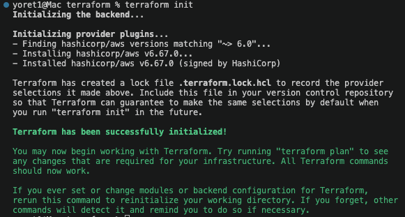

---

## Format Terraform

```bash
terraform fmt
```

---

## Validate Terraform

```bash
terraform validate
```

Expected result:

```text
Success! The configuration is valid.
```

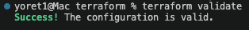

---

## Review the Terraform Plan

```bash
terraform plan
```

This displays the AWS resources Terraform plans to create.

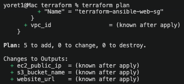

---

## Apply the Terraform Configuration

```bash
terraform apply
```

Enter:

```text
yes
```

when prompted.

Terraform provisions the AWS resources and displays the resulting outputs.

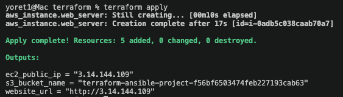

---

## Terraform Outputs

Run:

```bash
terraform output
```

Terraform returns:

- EC2 public IP
- Website URL
- S3 bucket name

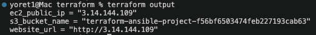

---

# AWS Resource Verification

## EC2 Instance

Terraform successfully provisioned the EC2 instance.

Instance name:

```text
terraform-ansible-webserver
```

Instance type:

```text
t3.micro
```

Availability Zone:

```text
us-east-2a
```

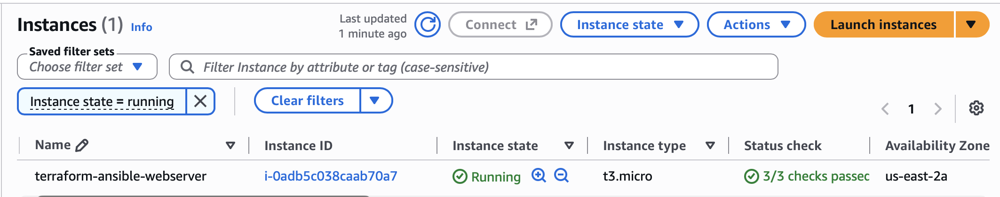

---

## S3 Bucket

Terraform successfully created the S3 bucket.

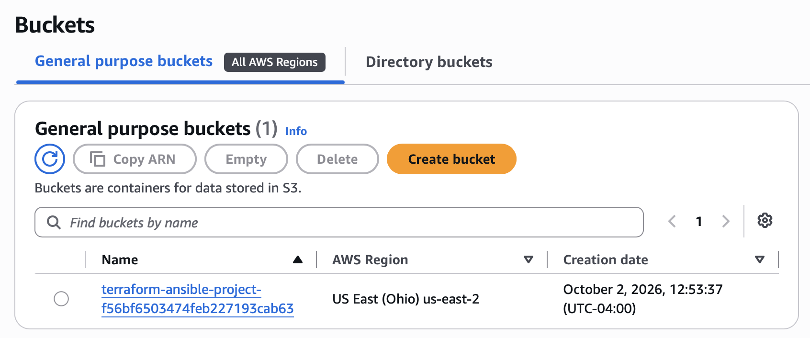

---

## IAM Role

Terraform created the IAM role used by the EC2 instance.

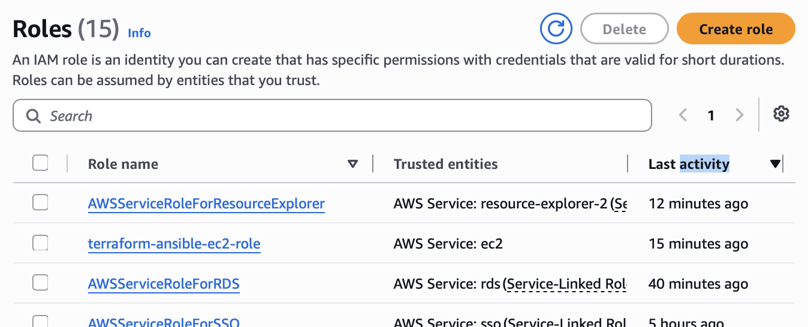

---

## Security Group

The security group provides SSH and HTTP access required for the project.

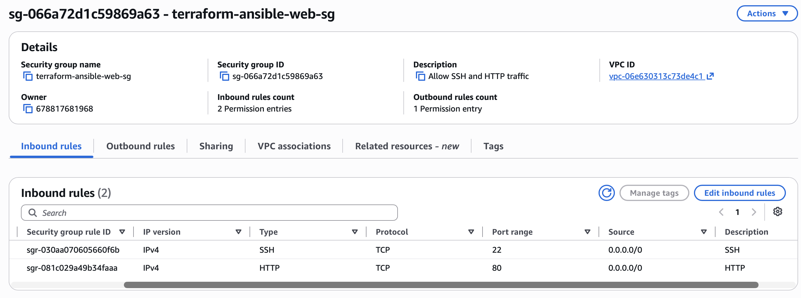

---

# Ansible Configuration

After Terraform creates the infrastructure, Ansible configures the EC2 instance.

The playbook performs the following tasks:

1. Connects to the EC2 instance through SSH.
2. Updates the Ubuntu package cache.
3. Installs Nginx.
4. Starts Nginx.
5. Enables Nginx at boot.
6. Deploys a custom `index.html` file.

---

## Ansible Inventory

The EC2 host is defined in:

```text
ansible/inventory.ini
```

Example:

```ini
[webservers]
EC2_PUBLIC_DNS ansible_user=ubuntu ansible_ssh_private_key_file="/path/to/private-key.pem"
```

The SSH private key itself is not stored in the repository.

---

## Test Ansible Connectivity

Change to the Ansible directory:

```bash
cd ansible
```

Test connectivity:

```bash
ansible all -i inventory.ini -m ping
```

Successful output includes:

```text
SUCCESS
"ping": "pong"
```

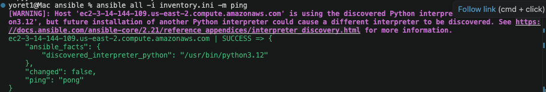

---

# Ansible Playbook

The playbook is located at:

```text
ansible/webserver.yml
```

Run the playbook:

```bash
ansible-playbook -i inventory.ini webserver.yml
```

A successful run shows:

```text
unreachable=0
failed=0
```

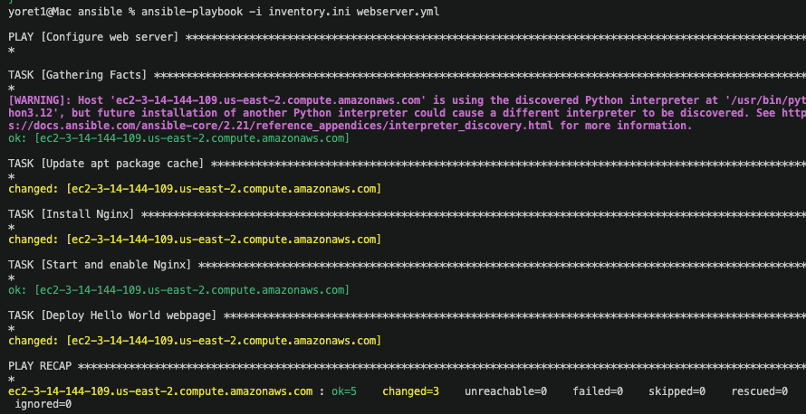

---

# Web Application

After Ansible completes, the website is available through the EC2 public IP.

Current deployment:

```text
http://3.14.144.109
```

The page displays:

```text
Hello, World!

Deployed with Terraform and Ansible on AWS.
```

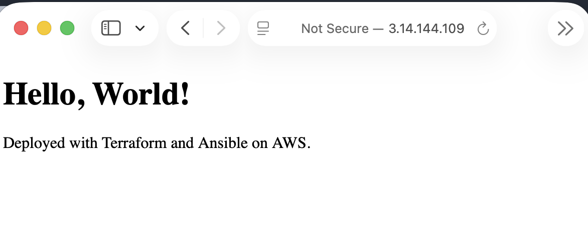

> Note: The public IP may change if the EC2 instance is stopped or recreated unless an Elastic IP is assigned.

---

# Terraform State Verification

Terraform tracks the AWS resources it manages in its local state.

Run:

```bash
terraform state list
```

The state includes resources such as:

```text
data.aws_ssm_parameter.ubuntu_ami
aws_iam_instance_profile.ec2_profile
aws_iam_role.ec2_role
aws_instance.web_server
aws_s3_bucket.project_bucket
aws_security_group.web_sg
```
stu
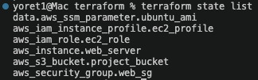

---

# Testing the Website

The website can also be tested from Terminal.

Using the EC2 public IP:

```bash
curl http://3.14.144.109
```

Or using the EC2 public DNS name:

```bash
curl http://EC2-PUBLIC-DNS
```

A successful response returns the HTML deployed by the Ansible playbook.

---

# How Terraform and Ansible Work Together

Terraform provisions the AWS infrastructure:

```text
Terraform
   |
   +-- EC2
   +-- S3
   +-- IAM
   +-- Security Group
```

Terraform answers:

> What infrastructure should exist?

Ansible configures the EC2 server:

```text
Ansible
   |
   +-- Connect to EC2
   +-- Install Nginx
   +-- Start Nginx
   +-- Deploy webpage
```

Ansible answers:

> How should the server be configured?

Together, Terraform and Ansible automate both infrastructure provisioning and server configuration.

---

# Security Considerations

Sensitive files are excluded from the repository.

The `.gitignore` file prevents the following from being committed:

```text
.terraform/
*.tfstate
*.tfstate.*
*.pem
terraform.tfvars
.DS_Store
```

Private SSH keys and Terraform state should not be stored in source control.

For a production environment, SSH access should be restricted to trusted IP addresses rather than allowing unrestricted access to port `22`.

---

# Cleanup

After the project has been reviewed, the AWS resources can be removed with Terraform.

Change to the Terraform directory:

```bash
cd terraform
```

Run:

```bash
terraform destroy
```

Review the destruction plan and enter:

```text
yes
```

Terraform will delete the AWS resources managed by this project.

---

# Results

This project demonstrates:

- Infrastructure as Code using Terraform
- AWS resource provisioning
- EC2 deployment
- S3 provisioning
- IAM configuration
- Security group configuration
- Configuration management using Ansible
- Automated Nginx installation
- Automated web page deployment
- SSH-based server management
- Git and GitHub version control

The final result is a working Nginx web server running on AWS EC2 and displaying a **Hello, World!** web page.